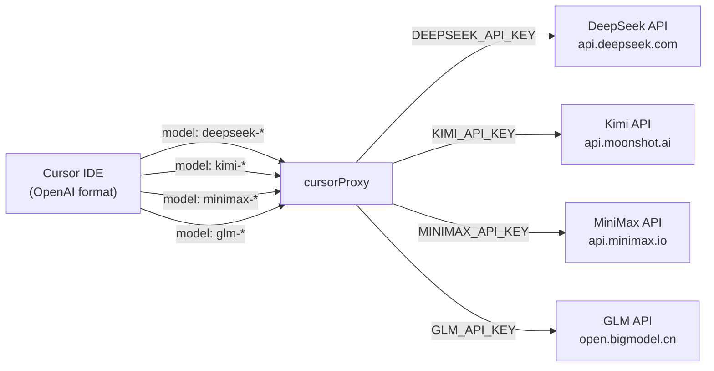
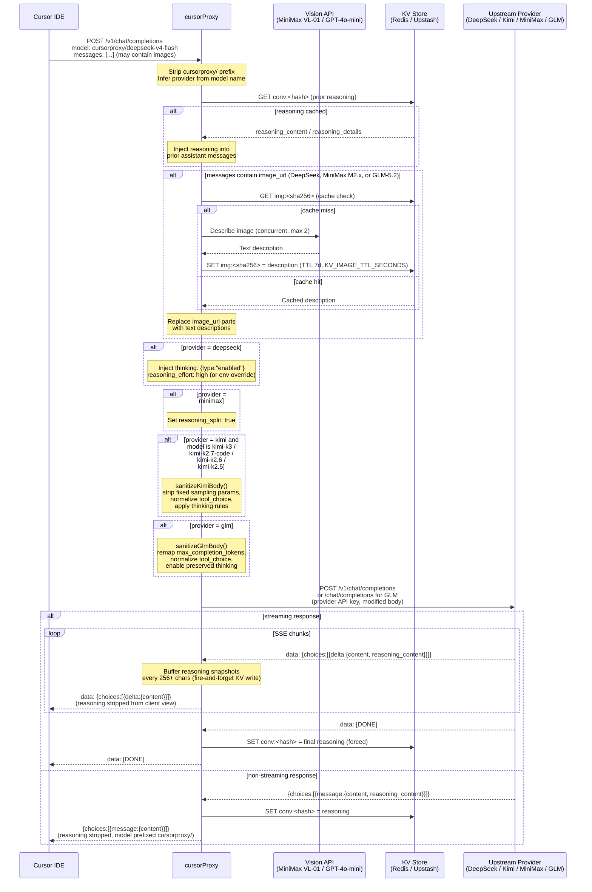
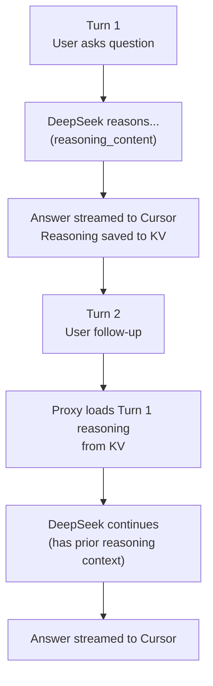
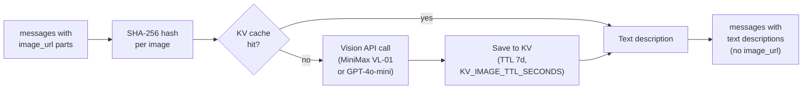

# DeepSeek / Kimi / MiniMax / GLM Provider Flow

## Model Routing

## Request / Response Flow

## Reasoning Caching (Multi-turn Reuse)

## Vision Bridge Detail (DeepSeek, MiniMax M2.x, GLM-5.2)

## Kimi Request Sanitization

Implementation lives in `lib/kimi.js` (`sanitizeKimiBody`). It runs for Kimi
thinking models before the reasoning bridge injects cached `reasoning_content`.
The default Kimi model is `kimi-k3`.

| Model | Thinking behavior | Proxy action |
|---|---|---|
| `kimi-k3` | Always on; full historical assistant messages must retain reasoning | Delete `thinking`; remove fixed sampling fields; force `reasoning_effort: "max"`; preserve forced `tool_choice` and `max_completion_tokens` |
| `kimi-k2.7-code` | Always on; Preserved Thinking always on; do not pass `thinking` | Delete `thinking`; strip fixed sampling params |
| `kimi-k2.6` | On by default; supports `thinking.keep: "all"` | Inject `{ type: "enabled", keep: "all" }` unless client disables thinking |
| `kimi-k2.5` | On by default; no `keep` support | Inject `{ type: "enabled" }` when omitted; strip `thinking.keep` |

The K2.x tiers also:

- Remove `temperature`, `top_p`, `n`, `presence_penalty`, `frequency_penalty`, and `reasoning_effort` (non-default values 400 upstream)
- Coerce unsupported `tool_choice` to `auto`
- Remap `max_completion_tokens` → `max_tokens` and floor low `max_tokens` to 16k

K3 removes the same fixed sampling fields but keeps `max_completion_tokens`
unchanged and does not rewrite `required` or named function tool choices. Its
reasoning cache scope includes `kimi-k3`; K2.x retains the legacy `kimi:<user>`
scope so existing cached conversations remain valid.

Kimi remains natively multimodal (images and video); the vision bridge is not used.

## TokenRouter (PaleBlueDot)

TokenRouter is a Chat Completions gateway at `https://api.tokenrouter.com/v1`.
cursorProxy matches first-version **family prefixes** and forwards the client
catalog ID unchanged (including `-free` and dated stamps). It does not publish
the rest of TokenRouter's catalog:

| Client model ID (examples) | Upstream ID | Request policy | Vision |
|---|---|---|---|
| `cursorproxy/moonshotai/kimi-k3` (`kimi-k3*`) | as sent | Reuses Kimi K3 sanitizer (`reasoning_effort: "max"`, no `thinking`, no fixed sampling) | Native images |
| `cursorproxy/deepseek/deepseek-v4-pro-0813` (`deepseek-v4-pro*`) | as sent | No native DeepSeek `thinking` / `DEEPSEEK_REASONING_EFFORT` injection | Vision bridge |
| `cursorproxy/deepseek/deepseek-v4-flash-0731` (`deepseek-v4-flash*`) | as sent | Same as Pro | Vision bridge |
| `cursorproxy/qwen/qwen3.8-max` (`qwen3.8-max*`) | as sent | Strip Cursor `thinking`; clamp `reasoning_effort` to `xhigh`/`medium`/`low`; no DashScope `enable_thinking` / `preserve_thinking` | Native images |
| `cursorproxy/z-ai/glm-5.2` (`glm-5.2*`) | as sent | Strip Cursor `thinking`; forward valid `reasoning_effort` (max\|xhigh\|high\|medium\|low\|minimal\|none); no GLM-native `thinking` / `tool_stream` injection; no `max_tokens` remap | Vision bridge |
| `cursorproxy/z-ai/glm-5.3` (`glm-5.3*`) | as sent | Same TokenRouter GLM policy as 5.2. Tried even if the live catalog has not listed it; an upstream 400 is returned as-is. | Vision bridge |

Family prefixes and an optional `tokenrouter/` prefix are matched **before**
native `kimi*` / `deepseek*` / `glm*` rules, so `cursorproxy/kimi-k3`,
`cursorproxy/deepseek-v4-flash`, and `cursorproxy/glm-5.2` still go to
Moonshot, DeepSeek, and GLM respectively.

There is no default TokenRouter model: missing or out-of-allowlist stems on the
`/tokenrouter/v1` route return `400 tokenrouter_model_unsupported`. If
TokenRouter itself rejects an allowlisted ID, that upstream status and body are
passed through. Cursor `developer` roles are rewritten to `system` because
TokenRouter rejects `developer`. Reasoning is restored hit-only under
`tokenrouter:<full-model-id>:<user>` (the forwarded client ID). When a
TokenRouter DeepSeek request carries `tools`, historical `reasoning_content`
is replayed across user turns.

Advertise chosen IDs (including `-free` variants) with `CURSORPROXY_MODELS` and
set `TOKENROUTER_API_KEY`. Optional `UPSTREAM_TOKENROUTER` accepts the base with
or without trailing `/v1`.

## GLM-5.2 Request Sanitization

Implementation lives in `lib/glm.js` (`sanitizeGlmBody`). It runs for GLM models
before the reasoning bridge injects cached `reasoning_content`.

- Default model is `glm-5.2`; `GLM-5.2` is accepted and forwarded to upstream as lowercase.
- Default upstream is ZHIPU China Coding Plan: `https://open.bigmodel.cn/api/coding/paas/v4`.
- Set `UPSTREAM_GLM=https://api.z.ai/api/coding/paas/v4` for the global Z.AI Coding Plan endpoint.
- Compatible gateways (litellm, Hosted_vLLM, OpenRouter-style aggregators) can also be used via `UPSTREAM_GLM`, but they reject the GLM-native fields `thinking` and `tool_stream` with HTTP 400 on plain (no-tools) requests. The proxy auto-detects the native Z.AI/ZHIPU hosts (`open.bigmodel.cn`, `api.z.ai`) via `isNativeGlmEndpoint()` and injects `thinking` / `tool_stream` only there; on any other host both fields are stripped. The detection is endpoint-scoped, not model-scoped: the same `glm-5.2` ID routes differently depending on the upstream host. `GLM_NATIVE_FIELDS` (`auto`/`true`/`false`) overrides the detection — `auto` (default) follows the hostname, `true` always injects, `false` always strips. The reasoning bridge's `clear_thinking` re-injection on KV miss is gated on the native hostname too, so it never re-adds `thinking` to a gateway request. Gateways emit `reasoning_content` in every response by default, so stripping `thinking` does not reduce reasoning quality. `reasoning_effort` is not gated (probed-accepted on gateways, and it is the GLM-5.2+ feature the project specifically forwards).
- The proxy remaps `max_completion_tokens` to `max_tokens`, coerces unsupported forced-tool choices to `auto`, preserves `tool_choice: "none"` by removing tools, and (on native hosts only) sets `tool_stream: true` for streamed tool requests and injects `thinking: { type: "enabled", clear_thinking: false }` when omitted.
- GLM `reasoning_content` is cached and replayed when available. On cache miss, the proxy does not inject placeholder reasoning and sets `clear_thinking: true` for that request because Z.AI requires preserved thinking to remain complete and unmodified.

## Key Environment Variables

| Variable | Purpose |
|---|---|
| `DEEPSEEK_API_KEY` | DeepSeek auth |
| `KIMI_API_KEY` | Kimi / Moonshot auth |
| `TOKENROUTER_API_KEY` | PaleBlueDot TokenRouter auth |
| `UPSTREAM_TOKENROUTER` | Optional TokenRouter base URL (default `https://api.tokenrouter.com/v1`) |
| `MINIMAX_API_KEY` | MiniMax auth (also used for `minimax_vl` vision backend) |
| `GLM_API_KEY` | GLM / ZHIPU AI auth |
| `UPSTREAM_GLM` | Optional GLM Coding Plan endpoint override |
| `GLM_NATIVE_FIELDS` | `auto` (default), `true`, `false` — inject/strip `thinking` + `tool_stream` based on native-host detection |
| `DEEPSEEK_REASONING_EFFORT` | `high` (default) or `max` |
| `VISION_API_PROVIDER` | `minimax_vl` (default) or `openai` |
| `VISION_API_KEY` | API key when `VISION_API_PROVIDER=openai` |
| `VISION_TIMEOUT_MS` | Per-image timeout (default 15 000 ms, 0 = disabled) |
| `VISION_CONCURRENCY` | Max parallel vision calls (default 2) |
| `KV_RETRY_DELAYS_MS` | Reasoning KV retry delays in ms, comma-separated (default `40,120,240,400`) |
| `KV_URL` / `KV_TOKEN` | Upstash Redis (Vercel) |
| `REDIS_URL` | Local Redis (Docker) |
